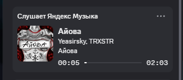

<div align="center">

# 🎵 Nowcast Pure

**Твой трек из любого плеера в статусе Discord — безопасно, плавно и без чужих серверов.**

[](https://github.com/Frozen-starTony/NowcastPure/releases)
[](LICENSE)
[](https://github.com/Frozen-starTony/NowcastPure)
[](https://github.com/Frozen-starTony/NowcastPure/issues)

<br>



</div>

---

> [!IMPORTANT]
> 🚧 **Проект находится в активной разработке!**  
> Весь базовый функционал уже полностью и стабильно работает: плавный таймер, поиск обложек в высоком разрешении (Яндекс Музыка, Deezer, Apple), режим AFK, очистка названий и умные кнопки.
> 
> **Есть идеи, как сделать программу ещё лучше?**  
> Мы открыты для любых фич и улучшений! Обязательно предлагайте свои идеи в [**Issues (Предложения)**](https://github.com/Frozen-starTony/NowcastPure/issues/new?template=feature_request.yml) или [**Discussions**](https://github.com/Frozen-starTony/NowcastPure/discussions).

---

## ✨ Возможности

* **Поддержка любых плееров Windows:**
  * 🎵 Яндекс Музыка (Desktop и браузер)
  * 🟢 Spotify
  * 🔴 YouTube & YouTube Music
  * 🔵 VK Музыка
  * 🟠 SoundCloud
  * 🟣 Apple Music / iTunes
  * 🎧 AIMP, Foobar2000, VLC, Windows Media Player
* **Официальные HD-обложки (512x512):**  
  Прямой поиск через официальные защищённые CDN (Яндекс Музыка, Deezer, Apple). Никаких сторонних подозрительных VPS и хостингов.
* **Идеально плавный таймер:**  
  Счётчик секунд тикает плавно, синхронно и без откатов на ноль.
* **Двойные умные кнопки:**  
  1. *«Слушать на YouTube»* — универсальная кнопка (откроется у любого друга).  
  2. *«Яндекс Музыка» / «Spotify» / «VK»* — прямой поиск в сервисе воспроизведения.
* **🧹 Умная очистка названий (De-cluttering):**  
  Автоматически убирает из названий визуальный мусор вроде `[Official Video]`, `(Official Audio)`, `(Slowed + Reverb)`.
* **🌙 Режим AFK на паузе:**  
  Когда трек на паузе или плеер выключен, статус переключается в стильный минималистичный режим перерыва со счётчиком времени отдыха.
* **🛡️ Защита от спама (Telegram и браузеры):**  
  Голосовые сообщения из Telegram и случайные видео из браузера можно заглушить одним кликом.
* **Вес всего ~35 КБ и 0% нагрузки:**  
  Написано на чистом C# (.NET Framework 4.8), не требует установки громоздких библиотек или Node.js.

---

## 🔒 Безопасность и Приватность

| Параметр | Другие утилиты из интернета | Nowcast Pure |
| :--- | :--- | :--- |
| **Слив на чужой сервер** | ❌ Загружают файлы на чужие VPS/IP | ✅ **0% (полная изоляция, нет чужих серверов)** |
| **Получение обложек** | ❌ Через сомнительные хостинги | ✅ **Прямой HTTPS к официальным CDN (Yandex/Apple)** |
| **Размер исполняемого файла** | ~170–500 КБ | ✅ **Всего 35 КБ** |
| **Сборка** | Закрытые или неизвестные `.exe` | ✅ **100% открытый код, сборка системным `csc.exe`** |

---

## 🚀 Быстрый старт

### Вариант 1: Скачать готовый бинарник
Скачайте актуальный релиз **`NowcastPure.exe`** из раздела [Releases](https://github.com/Frozen-starTony/NowcastPure/releases) и запустите.

### Вариант 2: Собрать самостоятельно (без установки SDK)
Благодаря тому, что в любую Windows 10/11 встроен компилятор .NET Framework 4.8 (`csc.exe`), сборка выполняется в 1 команду:

```powershell
git clone https://github.com/Frozen-starTony/NowcastPure.git
cd NowcastPure
powershell -ExecutionPolicy Bypass -File build.ps1
```

Через 2 секунды в папке появится готовый `NowcastPure.exe`.

---

## ⚙️ Настройки (`config.json`)

Все параметры можно переключать в 1 клик через контекстное меню в системном трее (правый клик по значку 🎵):

```json
{
  "AfkMode": true,
  "IgnoreTelegram": true,
  "IgnoreBrowser": false,
  "CleanTitles": true
}
```

* `AfkMode` — включает статус AFK при паузе трека.
* `IgnoreTelegram` — скрывает голосовухи и аудио из Telegram.
* `IgnoreBrowser` — игнорирует видео из браузеров (Chrome, Edge, Firefox).
* `CleanTitles` — вычищает скобки и лишний мусор из названий.

---

## 🤝 Вклад и Предложения

Проект развивается прямо сейчас! Будем рады вашим PR, отзывам и идеям.  
Пожалуйста, используйте [Issues](https://github.com/Frozen-starTony/NowcastPure/issues) для сообщений об ошибках и предложений новых функций.

---

## 📄 Лицензия

Распространяется под лицензией [MIT](LICENSE).
